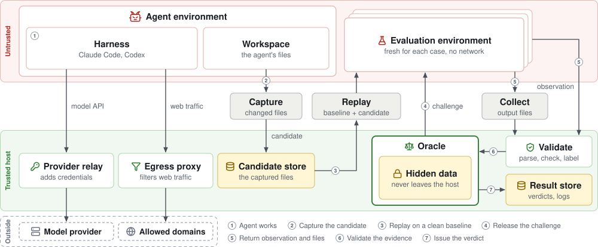

# SecureBench architecture

This document describes what SecureBench is and the rules it obeys. Implementation choices (modules, languages, Docker flags) belong in the code. Section 15 gives the reasons behind the less obvious choices.

## 1. Purpose

A coding-agent benchmark is useful only if its scores reflect how well agents complete the tasks. SecureBench assumes the agent, its workspace and everything it produces are adversarial. The agent may try to obtain protected evaluation material or to influence its own score. SecureBench therefore decides correctness outside every environment the agent's work can control.

The architecture applies privilege separation to benchmarks, and we call the result split verification:

- the agent develops a solution in an Agent environment that holds only public material;
- one bounded candidate is captured from that environment after it stops;
- when the candidate must run, it runs in a fresh Evaluation environment per case;
- a trusted Oracle on the host holds the hidden material and issues the verdict.

## 2. Vocabulary

| Term | Meaning |
|---|---|
| **Task** | One benchmark item: public instructions and assets, a baseline, a capture scope, checks, an Oracle and an allowed-domain list. Its metadata names the source benchmark. |
| **Run** | One execution of a set of tasks under one configuration (harness, model, limits, operator settings, seed). |
| **Agent** | The model and its harness, working in the Agent environment. Untrusted. |
| **Attempt** | One evaluation of one task within a run, from Agent start to verdict. |
| **Baseline** | The pinned image (by digest) that both the Agent and every Evaluation start from. |
| **Scope** | The declared set of paths that capture may read. |
| **Candidate** | The single durable result of the agent's work: (baseline, scope, delta). |
| **Check** | One way of observing the candidate. A passive check reads the candidate's files (`artifact_checks` in a task pack). An active check runs the candidate (`protocol_checks` in a task pack). |
| **Case** | One unit of an active check: one challenge released, one fresh Evaluation environment, one observation returned. |
| **Challenge** | The inputs of one case, released into its Evaluation environment. |
| **Context** | The hidden data of one case (expected answers), kept on the host. |
| **Adapter** | Untrusted code inside the Evaluation environment that turns a challenge into operations on the candidate and returns an observation. |
| **Observation** | What the adapter returns: typed JSON. Untrusted. |
| **Output file** | A declared file collected from the stopped Evaluation environment (`output_artifacts` in a task pack). Untrusted. |
| **Evidence** | Parsed observations and output files plus facts the host measured itself. |
| **Oracle** | Trusted host-side code that plans cases and judges evidence. |
| **Verdict** | The binary outcome of an attempt. |
| **Utility environment** | A short-lived, networkless environment that runs framework code over candidate data. |

## 3. Threat model

### 3.1 Agent and candidate

Two untrusted principals act on an attempt: the agent and its candidate. They see different material and reach different interfaces, so we model each one separately. The agent decides what the candidate contains, so both can serve one plan, made before capture.

**The agent** is the model and its harness, working in the Agent environment. It controls its workspace and so decides the candidate. It knows the public task and may misuse any communication path its policy permits: the provider relay and the task's allowed domains. It never receives a challenge, an evaluation input or hidden data (G1). We do not assume it is ignorant of material published elsewhere, such as the source benchmark. We assume it may know all of SecureBench's code and each task's adapter and Oracle logic: the only secrets are the run seed and each task's hidden data (its expected values and unreleased challenges). Its influence ends when the Agent environment stops: the candidate is fixed once captured, and the agent receives no feedback from evaluation.

**The candidate** is what the agent left in the scope, replayed in an Evaluation environment. It acts only as the agent built it to act. When it runs, it may compromise the entire Evaluation environment, including the adapter. Inside a case it sees that case's challenge, because the challenge is released into an environment it controls. It can fabricate output files and observations, including observations that match the declared schema. It has no network, sees no other case's challenge and keeps no state between cases (G3). We do not assume the adapter's observations are truthful.

Because the candidate knows the current challenge, SecureBench cannot rely on ignorance of hidden cases to make its evidence harmless to the host.

### 3.2 Trusted components

We trust:

- the benchmark authors, the task specifications and the Oracle code they write;
- the SecureBench host components: orchestration, capture validation, parsers and evidence handling;
- the provider relay and the egress proxy, which run in containers of their own;
- the isolation mechanism to enforce the boundaries it is configured with.

A bug in a trusted component can break evaluation integrity, so attacks that reach trusted components through SecureBench's own interfaces remain in scope: a crafted artifact against a parser, a crafted observation against the Oracle, a crafted request against the relay or proxy.

### 3.3 Mechanism and policy

Every environment combines a mechanism (the isolation technology, such as containers or microVMs) and a policy (which files, networks and services the environment may reach). SecureBench defines its boundaries and policies independently of the mechanism. The current mechanism is Docker on Linux.

We assume the mechanism enforces the boundaries it is configured with. Kernel, runtime and hypervisor escapes are outside our threat model. Configuring the mechanism correctly, and verifying that undeclared access is denied, is our responsibility (Section 8).

### 3.4 Security goals

- **G1 Mutual isolation.** The agent and the grader run in separate environments. The agent's work reaches the grader through one defined channel, and nothing else passes between them. That channel is the candidate: one bounded, replayable set of the files the agent changed within the task's declared scope, captured after the Agent environment stops. Everything else the agent changed, such as installed tools, running processes or edited system files, stays behind. Expected answers, acceptance conditions, grading assertions, scoring logic and unreleased cases stay on the host and never enter the Agent or Evaluation environment. Evaluation-only inputs never enter the Agent environment.
- **G2 Verdict integrity.** Only the Oracle decides whether an attempt passes. It accepts a candidate only when the evidence satisfies host-held acceptance conditions, so candidate claims, self-tests and fabricated observations cannot produce a pass. Data crafted to break the grader cannot produce one either. Evidence reaches the Oracle only through a single bounded, typed channel, which the host validates and binds to its case before use. This holds even when the candidate controls the environment that runs the tests.
- **G3 Test case isolation.** Each case is isolated from every other case. Candidate-controlled state from one case cannot affect another case, another attempt or another run. Each Evaluation receives only its own case's challenge.
- **G4 Access control.** The agent may only access resources that a configurable security policy explicitly allows. Each environment reaches only the resources its policy declares. Permission to use a service opens no route to host services or hidden material.

### 3.5 Non-goals

- **Vulnerabilities in the isolation mechanism.** Escapes that exploit a bug in the isolation technology itself, such as a vulnerability in the kernel or the container runtime. Configuring that technology is our responsibility (Section 8). An escape made possible by the configuration, such as through excessive privileges, an exposed host service or a missing network rule, is a flaw in SecureBench and remains in scope.
- **Misuse of an allowed service.** A policy over network destinations cannot control what the agent does within a service it is allowed to reach. An agent could read published material there, or store data on the service for a later run to retrieve.
- **Hardware side channels.** Side channels based on hardware timing or resource contention. Leaks through software, such as files shared between runs, remain in scope.
- **Weak acceptance conditions.** SecureBench enforces what a task declares. Whether the acceptance conditions fully capture the intended task is the author's concern (Section 12). A grader that checks only the result cannot tell a shortcut from an intended solution.
- **Published benchmark material.** SecureBench keeps hidden data out of the agent's reach. It cannot hide what the benchmark has already published, such as its tests and solutions.

## 4. Components and information flow



Green marks trusted components, including the relay and the proxy, which run in containers of their own. Red marks untrusted environments, gray marks utility environments and yellow marks stored data. The numbers mark the seven steps of one attempt, from the agent's work to the verdict.

Every task resource belongs to one visibility class:

| Class | Agent | Evaluation | Host / Oracle |
|---|---|---|---|
| `public` | yes | no | yes |
| `evaluation_inputs` (adapter, evaluation-only files) | no | yes, read-only | yes |
| `hidden` (expected answers, case corpora, Oracle code) | no | no | yes |

The task specification's structure fixes each resource's class. A public file that the Evaluation needs is also placed among the evaluation inputs. Hidden data is never mounted into any environment.

## 5. Candidate model

### 5.1 Definition

A candidate is **(baseline, scope, delta)**.

- The **baseline** is the pinned image digest. When a task declares a repository commit, pack validation also confirms that the image holds a clean repository at that commit.
- The **scope** is a list of roots, each with optional excludes and bounds (entry count and bytes), plus bounds for the scope as a whole. The scope always excludes the mount points of evaluation inputs and framework-protected paths. It excludes `**/.git` by default; a task may include a `.git` directory by listing it explicitly in its scope, and it is then captured as plain files. Nothing trusted ever runs Git on candidate data. A delta may not delete, or change the type of, any ancestor directory of an evaluation input's mount point; otherwise a candidate could replace a parent directory with a symlink and redirect where the inputs are mounted.
- The **delta** is a manifest plus blobs. The manifest lists every path inside the scope that differs from the baseline, as one entry:
  - `write`: a regular file, with its executable bit and the SHA-256 of its full content;
  - `dir`: a directory, including empty ones;
  - `symlink`: an internal symlink, where the scope permits them;
  - `delete`: a baseline path that no longer exists.

Blobs, the full file contents, are stored in the candidate store, each in a file named after its SHA-256 hash.

A candidate's identity is the digest of its manifest. There is one candidate type. Repository patches, selected output files and system-state changes are the same structure with different scopes.

### 5.2 What survives replay

Replay preserves file content, file type (regular file, directory, internal symlink) and the executable bit. Ownership, other permission bits, extended attributes and hard links are normalized to fixed values, and timestamps to the time of replay. Processes, memory, mounts, credentials, environment variables and network state never survive.

### 5.3 Capture

After the Agent environment stops, a utility environment mounts the stopped workspace read-only, walks the scope, hashes every file and compares it against the baseline index. The baseline index lists the hash and executable bit of every baseline file inside the scope. It is computed once per image, from the pinned image, and never from an Agent environment.

The delta is computed in this way:
- If the hash or the executable bit differs from the baseline, or the file is new, it becomes a `write` entry.
- If a directory is new, including an empty one, it becomes a `dir` entry.
- If an internal symlink is new, or its target differs from the baseline, it becomes a `symlink` entry, where the scope permits symlinks.
- If a baseline path is missing, it becomes a `delete` entry.
- If the hash and the executable bit are the same, the file is skipped.

During capture nothing from the workspace is executed and special files (devices, sockets, named pipes), symlinks that leave the scope or that the scope does not permit, entries that capture cannot read, and bound violations are rejected. Any of these fails the attempt with the failure class `capture`.

The host validates the utility environment's output: its strict schema, blob hashes, every path inside the scope and outside its exclusions, and all bounds. The host then builds the manifest itself. A compromised capture environment can therefore produce only a candidate the agent could have produced anyway.

A deliverable that is missing is a normal state of the delta. Whether its absence fails the task is the Oracle's judgment.

### 5.4 Replay and lookup

Replay starts from the pinned baseline and applies the delta's entries. It happens only inside the isolation mechanism, in a utility environment, and refuses any baseline whose digest differs from the candidate's.

Passive checks read files from the stored candidate by lookup, without replaying it: a `write` entry returns its blob, a `delete` entry means absent, and any other path returns the baseline's content. A passive check can also list the entries under a path (paths, types, sizes and hashes), which lookup answers from the manifest and the baseline index.

### 5.5 Interoperability

SecureBench has no export format. To compare its verdicts with a benchmark's native grader, the conversion campaign runs the same candidate script in both graders (`conversions/campaign.py`). That comparison sits outside the evaluation path, so a problem in it can affect a comparison with a native grader, never a SecureBench verdict.

## 6. Case model

### 6.1 Structure

```
Task
 ├─ Candidate
 ├─ Passive checks (0..n)     read the candidate by lookup; no environment
 └─ Active checks (0..n)
     └─ Cases (1..n)           fixed list from the Oracle's plan
         ├─ Challenge          released into this case's Evaluation only
         ├─ Context            kept on the host
         └─ Evidence           observation + output files + host facts
Verdict                        one per attempt
```

### 6.2 Rules

1. **One challenge in, one observation out.** A case can contain several operations, but the Evaluation receives all of its inputs at once. There are no interactive cases. The framework enforces the challenge's size bound. What the challenge contains is the author's responsibility (Section 12).
2. **Operations inside one case share state.** Anything that must be independent goes into a separate case.
3. **The case list is fixed before evaluation starts.** The Oracle's plan may generate cases from the run seed. Cases do not depend on earlier evidence.
4. **Shared setup.** Work that needs no challenge (such as a build) may run once on the replayed candidate. Its filesystem is snapshotted, and every case starts from its own copy. The snapshot is candidate-controlled, falls under the same limits, and a setup failure fails the attempt with the failure class `setup`.
5. **Order and parallelism.** Passive checks run first. If they pass, all cases run in parallel, up to four at a time. The first failed case cancels the rest.
6. **All must pass.** An attempt passes only if every passive check and every case passes.

## 7. Evidence channel

### 7.1 Pipeline

Steps 5 and 6 of the figure in Section 4 show this pipeline. Output files are collected in a utility environment.

1. **Collect.** The host reads the adapter's response with a size bound. Output files are collected from the stopped Evaluation environment by a utility environment, under the same rules as candidate capture.
2. **Parse.** The response is parsed as strict JSON: one value, no duplicate keys, no non-finite numbers. Output files are parsed by registry parsers.
3. **Validate.** The observation must match the adapter's declared schema. The host reads that schema from its own copy of the task pack, never from the Evaluation environment.
4. **Bind.** The host labels the evidence with its case, check and attempt. The host started this Evaluation environment and read the response from it itself, so it already knows which case the evidence belongs to. The adapter does not need to report any identifiers.

The evidence also carries host-measured facts: how the case ended (returned, timed out, killed for memory, output exceeded, crashed) and its duration. Duration serves timeouts and diagnostics. It is not an acceptance criterion.

The adapter may report that it could not exercise the candidate, instead of returning an observation. For example, the adapter of a repository task first builds the patched program; if compilation fails, it returns "build failed" with the compiler's exit status. The adapter only reports what happened and compares nothing against expected answers. The report is recorded as a diagnostic, and the case fails because no observation was returned. Adapter stdout and stderr are not surfaced.

### 7.2 Adapter

Each active check names an adapter, delivered as an evaluation input. Its contract declares the challenge schema, the observation schema, the output files to collect and hard limits (time, challenge size, observation size). The host enforces that contract from its own copy of the task pack.

The adapter is assertion-free: it contains no expected answers and makes no correctness judgment. It may validate inputs and enforce protocol bounds. Its implementation need not be secret, and SecureBench assumes the candidate can take over the adapter process. Nothing the adapter returns is trusted beyond what the Oracle can check against its own expectations.

### 7.3 Observations

Observations are typed JSON. Schemas declare types, field counts and collection sizes. Every string field declares a maximum length, and pack validation rejects a schema without one. Strings must be well-formed Unicode, which the strict JSON parser enforces. A string field may also declare an enumeration of allowed values. Schemas do not support patterns or character sets, so no regular-expression engine is part of SecureBench's validation code.

Values that have structure are declared as typed fields instead of being encoded in text. A list of sorted file names is an array of bounded strings, and a count is an integer. SecureBench's own validation code then checks the structure, and the Oracle only compares values. When a task's output is text by nature, such as the lines a program prints, each line is a bounded string. Whether a string has the right format is a correctness question, so the Oracle checks it (Section 7.5).

### 7.4 Parsers

The parser registry holds two formats: UTF-8 text (returned as text and as a list of lines) and strict JSON. These cover answer files that a passive check reads without running anything.

Any other format (CSV, calendars, numeric arrays, Git repositories, binary files) is handled by an active check: the adapter parses it inside the Evaluation environment and returns a typed observation, and the Oracle compares the values. A parser is added to the registry only for a format that an active check cannot handle. Task-specific parsers are not permitted.

Parsers belong to the trusted computing base. They enforce bounds, never activate content as code (no pickle, no YAML tags, no object arrays) and have adversarial tests.

### 7.5 Oracle contract

The Oracle consists of two functions.

- **plan(task, seed) → cases.** Produces the fixed case list, each case being a challenge and a context. It reads the task's own hidden data, which holds every value the judge compares evidence with, so the Oracle's code shows how a task is graded without revealing an answer. The one exception is an upstream test that draws random inputs at run time: there plan draws them from the run seed and computes their expected values as upstream's test does.
- **judge(context, evidence) → pass or fail, plus a diagnostic.** It is deterministic and free of side effects: no network, no files, no processes. It never evaluates, deserializes, executes or uses as a path or command any value taken from the evidence. Computation is permitted, using only a fixed list of pure standard-library modules and SecureBench's own evidence types, which pack validation checks. Evidence is compared, never interpreted as code. The judge does not apply regular expressions to evidence. A format check (for example, that a value is a valid UUID) is written as a simple hand-written check on the bounded string.

Anything that requires executing candidate-derived content happens in the Evaluation environment. The Oracle checks the results against answers it holds.

The Oracle runs on the host without a sandbox. This relies on the framework guaranteeing well-formed, bounded evidence (Sections 7.1 to 7.4) and on the contract above, which is enforced by review and by static checks on Oracle code. Its process has a time limit on every request and a 4 GiB memory limit, so an Oracle that a candidate drives into unbounded work fails its check instead of exhausting the host.

## 8. Isolation backend contract

### 8.1 Operations

| Operation | Purpose |
|---|---|
| create(image digest, mounts, network, limits) | Agent, Evaluation and utility environments |
| exec(command, input, timeout, output bound) | run the harness or the adapter; report how it ended |
| stop | end an environment so that no process survives |
| snapshot / clone | shared setup once, a copy-on-write clone per case |
| destroy | remove an environment and everything it wrote |
| network(none, or restricted to named peers) | Agent environment only: its peers are the run's relay and proxy |

### 8.2 Guarantees

| # | Guarantee | Goal |
|---|---|---|
| B1 | An environment sees only its declared mounts. Read-only mounts stay read-only. Hidden data is never mounted. | G1 |
| B2 | After stop, no process keeps running. Only what capture reads crosses to evaluation. | G1 |
| B3 | Environments share no writable state: parallel cases, other attempts, other runs and the setup snapshot, which is cloned and never written in place. | G3 |
| B4 | Destroy is complete: no leftover layers, volumes, networks or processes. | G3 |
| B5 | No network by default. A restricted network reaches only its named peers: no host gateway, host services, container runtime socket, cloud metadata endpoint or other runs. The upstream network of a run's relay and proxy reaches only global addresses: no host gateway, host services, cloud metadata endpoint or private ranges. | G4 |
| B6 | Every exhaustible resource (memory, CPU, processes, disk, output size, time) is capped per environment. The backend reports when a case hits its time, memory or output limit; exhausting processes, CPU or disk ends the case inside its own environment, as a crash, a timeout or a normal exit. | error attribution |
| B7 | No privilege gain: no privileged mode, all capabilities dropped (the Agent environment keeps only `CHOWN`, `DAC_OVERRIDE`, `FOWNER`, `SETGID` and `SETUID`), no new privileges, default system-call filtering, no device access. | mechanism boundary |
| B8 | Images are used only by pinned digest, verified before each use. | reproducibility |

### 8.3 Environments

- **Agent environment.** Starts from the baseline with public assets mounted read-only and its workspace in the container's own writable layer, capped in size. It reaches only its run's provider relay and egress proxy. It is the only environment that keeps any capability: the five listed in B7, so that package managers work as root. When it has a proxy, the framework adds a sudoers drop-in so that `sudo` keeps the proxy variables.
- **Evaluation environment.** Starts from the replayed candidate (or the setup snapshot), with evaluation inputs and the stock Python interpreter mounted read-only on top of it, so the candidate cannot shadow them. It has no network.
- **Utility environments.** Networkless environments that run framework code over candidate data: building the baseline index, capture, replay and output file collection. The host never reads an untrusted filesystem directly and validates everything a utility environment returns. Utility environments need no trust beyond isolation: compromising one yields only data the agent or the candidate already controls.

### 8.4 Limits and platform

Resource limits are global for a run and recorded in provenance. Admitted runs use Linux workers only.

### 8.5 Qualification

Each run starts with a configuration check of the worker: a Linux daemon, Docker 28 or later, cgroup v2, system-call filtering and a live disk-quota probe. Image digests, network settings and capabilities are checked at each use. Each worker passes a live test suite with positive and negative tests for B1 to B8 before admitted runs, and again after changes to the kernel or the container runtime. Results record the worker's qualification.

## 9. Agent side

### 9.1 Harness

The harness (Codex, Claude Code with an API key or a subscription token, or a scripted command) runs inside the Agent environment, from a pinned version and a tooling overlay mounted read-only. The harness is untrusted: the model's tool calls run beside it and can alter it. Its reports never affect the verdict. Only the captured candidate crosses into evaluation.

The agent receives the task's public instructions verbatim, plus only the harness's own system prompt. The framework adds no wording of its own, and never reveals the capture policy. A requirement that a converted task needs beyond the original instructions is written into that task's instructions, where it is reviewed as a fidelity change. The agent receives no feedback from evaluation.

When the Agent time limit expires, the environment is stopped and the candidate is captured and evaluated normally.

### 9.2 Provider relay

The relay holds the provider credentials and injects them outside the Agent environment. Credentials never enter any environment.

- It forwards only each provider's inference endpoints, by exact path and with `POST` only. It injects an API key or a Claude Code subscription token. The Codex subscription mode is not supported.
- It blocks everything that lists or enumerates stored objects (file uploads, vector stores, batches). Another run on the same account could find such objects, so they would form a channel between runs. Server-side conversation state that is addressable only by an identifier issued within the run (such as a previous response identifier) is harmless: a later run has no way to learn the identifier.
- It blocks provider-hosted tools (web search, code execution, remote MCP servers) unless the operator enables them. The relay recognizes the client-tool shape of each provider API. Every other tool declaration counts as provider-hosted, and requests it cannot inspect are blocked.

### 9.3 Egress proxy

The proxy permits the task's allowed domains and their subdomains, on ports 80 and
443. It resolves names itself, rejects private and reserved addresses, and requires the TLS server name to match the requested host. It does not intercept TLS.

An allowed domain grants full access to that service. The agent can use it in any way the service permits, including reading published solutions or storing data that a later run reads back. SecureBench cannot prevent this. Choosing safe domains is the author's responsibility (Section 12).

### 9.4 Network declaration

Each task declares one list of allowed domains. An empty list means no egress; the relay remains available for model access. Operators cannot override or extend task declarations. Each run has its own restricted network and relay and, when the task allows a domain, its own proxy.

### 9.5 Logs

The relay and proxy logs are trusted records of model traffic and egress. Harness transcripts are recorded too and labeled untrusted. None of them affect the verdict.

## 10. Errors and verdicts

| Where the error occurs | Result |
|---|---|
| Capture (bounds, special files, escaping symlinks) | `failed`, class `capture` |
| Shared setup | `failed`, class `setup` |
| Inside an Evaluation (adapter crash, timeout, memory kill, malformed or out-of-schema response, unreadable output file) | `failed`, class `case_error` |
| Oracle judgment | `failed`, class `oracle` |
| On the host during a case (container runtime failure, host resources, framework bug) | the case is retried, up to a configurable count (default 2); `invalid` if it still fails |
| On the host during the Agent phase or capture | `invalid` immediately |

The rule attributes errors to the zone where they occur. Everything inside an Evaluation environment is candidate-controlled, so errors there always count as failures; the class `case_error` keeps them distinguishable from wrong answers. Per-environment limits (B6) ensure that exhaustion caused by a candidate hits its own environment and never the host. Otherwise a candidate could convert its failure into an invalid attempt.

A case retry is an exact repeat: the candidate is fixed and the environment fresh. The Agent phase cannot be retried the same way, because a new Agent run produces a different candidate. Whether to start a new attempt after an invalid one is a decision at the run level, and both attempts are recorded (Section 11).

An expired Agent time limit is not an error. It is recorded in the result, and the candidate is captured and evaluated normally.

Verdicts are binary. An attempt is `passed`, `failed` or `invalid`.

## 11. Outputs

All outputs stay on the local host. The operator is trusted, and Oracle diagnostics may contain full detail, including expected values.

For every attempt SecureBench stores:

- **the result record:** status, failure class, diagnostics and provenance;
- **the candidate:** manifest and blobs;
- **the evidence:** observations and output files for every case that ran;
- **the logs:** relay, proxy and harness transcript.

The Oracle is a deterministic pure function and the evidence is stored, so anyone with the task pack can recompute every verdict offline without running anything.

**Provenance** in each record:

- task: manifest, task, image, baseline index and Oracle code digests;
- candidate digest;
- framework: SecureBench commit, whether its code had uncommitted changes, and execution-contract version;
- agent: harness version, tooling overlay digest, model, reasoning effort;
- run configuration: global limits, seed and the operator settings listed below;
- worker: qualification record identifier.

**Integrity.** Attempts are append-only. Retries and invalid attempts are recorded, never overwritten. SecureBench maintains a run manifest with the hash of every record and writes a root digest when the run ends. An interrupted run may resume only when its provenance matches exactly.

**Untrusted data.** Candidates, evidence, tool results inside relay logs and harness transcripts contain agent-controlled content. They are stored as bounded bytes, escaped when displayed, and marked as data when an LLM reads them.

SecureBench publishes nothing itself. Run records that leave the local host carry full diagnostics, so whoever releases them decides whether the hidden data they contain may be public. The records released with this repository contain expected values, and the packs here publish the same values.

### Operator configuration

| Setting | Default |
|---|---|
| Provider-hosted tools allowed | off |
| Host-error retries per case | 2 |
| Global resource limits | set per run |

All settings are recorded in provenance.

## 12. Responsibilities of the benchmark author

SecureBench enforces what a task declares. The author is responsible for the declaration being sound:

1. **Scope.** The capture scope covers every valid solution the public prompt allows. The agent never sees the capture policy, so the prompt must define every deliverable.
2. **Challenges.** A challenge contains only what its case needs and leaks no other hidden material.
3. **Domains.** Allowed domains are safe: the answer is not reachable on them, and they offer no useful channel between runs.
4. **Oracle.** The Oracle follows the contract in Section 7.5 and states the task's acceptance conditions correctly. Expected values come only from the task's hidden data, apart from the exception in Section 7.5, never from evidence or from files the candidate's delta can change.

## 13. Limitations

- **Trusted external state.** Tasks whose correctness depends on a trusted record of the candidate's outbound effects, on a service the candidate must query without reading its secrets, or on traffic between several candidate instances are not supported. Trusted measurements made outside the Evaluation environment could add this later as a new source of trusted evidence.
- **Host actions on the Evaluation.** Signals, restarts, clock control and fault injection are not supported.
- **Speed targets.** Performance thresholds relative to a reference are not supported.
- **Network during evaluation.** Evaluation environments have no network.
- **Properties spanning several cases.** Each case is judged alone, so properties such as identical output across fresh runs must fit inside one case.
- **How a computation ran.** Properties about the execution itself (a leak report from an in-environment tool, the authenticity of a training run) cannot be trusted, because the candidate controls the whole Evaluation environment.
- **Allowed domains.** An allowed service is fully usable by the agent (Section 9.3).
- **Provider-hosted tools.** When enabled, the network policy covers only traffic from inside the Agent environment.
- **Metadata.** Only content, file type and the executable bit survive replay.
- **Privileged services.** Evaluation environments run without capabilities, and the Agent environment keeps only the five that package managers need (B7). Tasks that need more, or that need these during evaluation, are not supported. Services that run as their own users (for example a mail server) are the common case.
- **Unreadable files.** Capture runs without capabilities, so files the agent made unreadable (for example mode 000, or owned by another user with restrictive permissions) fail the attempt. Tasks that depend on such files are already out of reach, because ownership and permissions do not survive replay.

## 14. Goals and mechanisms

| Goal | Mechanisms |
|---|---|
| G1 Mutual isolation | visibility classes, B1, per-case challenge release, author responsibility for challenges and domains; capture after stop (B2), utility-environment capture with host validation, one candidate type |
| G2 Verdict integrity | Oracle-only verdicts, typed evidence, Oracle contract, all-must-pass; collect, parse, validate and bind pipeline; parser registry; host-owned schemas; B6 |
| G3 Test case isolation | fresh Evaluation per case, cloned setup snapshot, B3, B4 |
| G4 Access control | per-run restricted network, relay, proxy, single domain list, no Evaluation network, B5 |

## 15. Why the less obvious choices

The task counts below come from an audit of the source benchmarks on 2026-09-29 and 2026-09-30, made against all 202 tasks of the two benchmarks (113 DeepSWE, 89 Terminal-Bench) and 70 Oracles written for an earlier prototype.

### Scope of the framework

- **No trusted helper services or host actions (Section 13).** 7 tasks need a trusted helper service outside the Evaluation environment (4 a trusted record of outbound effects, 2 a service holding secrets, 1 a relay between peers), and 6 need a host action on the Evaluation (4 speed targets, 1 restart, 1 signal): 12 tasks, about 6%. Helpers were the largest source of complexity and the only place where trusted code handled adversarial network input. A small core we fully understand is worth more than the last 6%; helpers remain an extension point.
- **Speed targets are a limitation.** A speed target compares against a reference, which would have to run under identical conditions on the same worker. That adds a concept for 4 tasks.
- **No network during evaluation.** Without helpers, no Evaluation needs a network, and all network machinery on the evaluation side disappears.

### Cases

- **No interactive cases.** A case whose next input depends on the candidate's previous answer, while staying hidden until then, is a service holding secrets: the trusted helper service we dropped.
- **Fixed case lists, run in parallel.** Adaptive case selection would offer early stopping, generated cases and failure-driven case choice. Sequential execution with early stopping gives the first, the run seed the second, and under all-must-pass the third affects only diagnostics. Adaptivity would have cost the parallelism that runs over many tasks, conditions and repetitions need.
- **All must pass, binary verdict.** Terminal-Bench and DeepSWE both score tasks as pass or fail, so matching them keeps the comparison with native grading direct. Because the rule is fixed, Oracle authors cannot get the aggregation wrong. The cost is that no property can span several cases.

### Errors

- **Errors are attributed to the zone where they occur.** Counting Evaluation errors as `invalid` would let a candidate that cannot solve a case crash the adapter on purpose, turning its failure into a missing result that leaves the denominator. Host errors cannot be caused by the candidate as long as limits apply per environment (B6); without per-environment disk quotas a candidate could fill the host disk, which is why quotas are a guarantee.
- **No option to count Evaluation errors as `invalid`.** The failure class `case_error` already separates "the candidate failed" from "something broke during the case", so such an option would add no information and only reopen the path from failure to missing result.
- **Retry cases, never the Agent phase.** A case repeats exactly, because the candidate is fixed and the environment fresh. A new Agent run produces a different candidate, so a host error there makes the attempt `invalid`, and starting a new attempt is a separate, recorded decision.

### Evidence channel

- **The Oracle runs without a sandbox, under a pure-function contract.** Of the 70 audited Oracles, none ran processes or shell commands, none deserialized unsafely, none used the network or third-party libraries, and 13 read files, all their own hidden data. The contract describes what Oracles already did, and writing it down makes running without a sandbox defensible. Bounding the Oracle's work over candidate data is still the task's job, but reviews kept finding Oracles that sized memory from evidence, so the Oracle's process also has a memory limit: a case review misses fails the check instead of reaching the host.
- **Typed observations over raw text.** In the same audit, 26 Oracles converted evidence strings to numbers and 10 ran regular expressions on them. That moves parsing of adversarial input into unreviewed Oracle code, and a regular expression on a candidate string can stall the host. Typed schemas move that parsing into the framework.
- **Two parsers.** Every parser sits in the trusted computing base, so each must earn its place. UTF-8 text and strict JSON cover most answer files, which a passive check reads without starting an environment. Any other format is parsed by an adapter inside the Evaluation; a forged parse only helps a candidate that already knows the hidden answer.
- **Bounded strings, and no regular expressions over evidence.** A maximum length and well-formed Unicode are what protect the host. Character sets and patterns would make schemas stricter without making the host safer when the Oracle only compares values, and supporting them would put a regular-expression engine, which can backtrack for a very long time on a crafted string, into trusted code. The same risk applies inside the Oracle, so format checks there are simple hand-written code.
- **Binding by construction.** An adapter that echoes case identifiers proves nothing, because it can copy them from its request. The host created the Evaluation environment and read the response from it itself, which binds the evidence without the adapter's help.
- **Standard output and standard error are not surfaced.** They are untrusted and add nothing to the verdict; the adapter's explicit "could not exercise the candidate" response gives the useful diagnostic.

### Candidate

- **One candidate type.** Repository patches, selected output files and system-state changes are the same structure at different scopes.
- **Full-content blobs.** Storing full file contents instead of diff hunks lets passive checks read files by lookup, so nothing is materialized on the host. The cost is storage for large files with small changes, which the bounds cap.
- **Hashing every file.** Hashing a 1.2 GB tree of 32,247 files took 4.3 seconds on one core. Change detection by size and modification time is unsafe, because the agent controls modification times and could hide a change.
- **Only content, type and the executable bit survive.** No known task depends on ownership or timestamps. This matches Git's own model, and more metadata can be added if a task needs it.
- **`.git` is excluded by default, with an explicit opt-in.** Nothing trusted runs Git on candidate data, so including `.git` carries little risk: capture reads it as plain files, and replay writes it into an environment the candidate already controls. The cost is noise: normal work changes the index, logs and objects constantly. A task graded on repository state lists its `.git` directory explicitly.
- **Unreadable files fail capture.** An agent runs as root in its environment and can make files unreadable without escalating (`chmod 000`, or a restrictive owner). Capture runs without capabilities and cannot read them, and we treat that as a capture failure instead of granting capture a capability. The honest cases this rejects (service data owned by a service user) are out of reach anyway, because replay does not preserve ownership or permissions.
- **Missing deliverables are judged by the Oracle.** A missing file is a normal state of a delta. Under all-must-pass the verdict is the same as a capture failure, and the rule keeps capture free of task semantics.

### Isolation

- **Utility environments.** If the host walked agent-controlled directory trees itself, it would need `DAC_OVERRIDE` and a permission repair step, and it would be exposed to crafted paths and symlinks. Running capture, replay and collection in networkless utility environments removes all three. They need no trust of their own: the host validates their output, and compromising one yields only data the agent or the candidate already controls.
- **Global limits per run.** Per-task limits would add a field to every task for little gain. Recording the limits in provenance keeps any gap with native harnesses visible.

### Agent side

- **One domain list and no overrides.** Separate network modes were misleading (an "internet" mode with an empty list granted nothing), and operator overrides made every task reach every other task's domains. Least privilege is fixed per task when it is converted.
- **The domain allowlist's limits are accepted.** Restricting paths would mean terminating TLS, which requires installing a certificate authority in the Agent environment, and some tools reject it. We state plainly that an allowed service is fully usable, including for finding published solutions.
- **The prompt is the task's instructions.** Framework text added to the prompt (such as "do not edit tests") is not in the native benchmarks and reveals part of the capture policy. Using the instructions verbatim keeps prompts identical to the source, and any extra requirement becomes a visible, reviewed part of a task.
- **The relay blocks what another run could find.** The question is whether stored data can be found by another run, not whether storage exists. Listable stores (files, vector stores, batches) can be enumerated by any run on the same account, so they are always blocked. A stored response addressed only by an identifier issued within a run is unreachable from later runs, because carrying the identifier across would itself require a channel.
- **Provider-hosted tools are an option, classified by API shape.** Listing every provider tool across every harness is infeasible, but each provider API has only one or two client-tool shapes. Treating everything else as provider-hosted is small to maintain and fails closed when a provider adds a tool.
- **Transcripts are always recorded.** Candidates, evidence and relay logs already hold agent-controlled content, so treating transcripts differently would be a double standard. The realistic risk, prompt injection into later analysis by a model, applies to all agent-controlled text and is handled by one rule (Section 11).

### Outputs

- **Local only, with full diagnostics.** SecureBench publishes no results itself, and the operator is trusted and already sees the hidden material, so restricting diagnostics would protect against nobody.
- **Offline re-judging.** A deterministic, pure Oracle plus stored evidence means every verdict can be recomputed without running anything.
- **Append-only attempts and an automatic run digest.** Recording every retry and invalid attempt keeps pass rates honest. The digest detects accidental edits or truncation and shows that a run's record set is complete.
